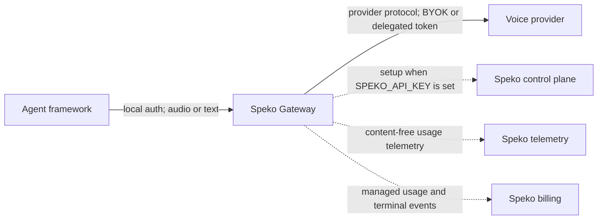

# Trust and data flow

This document says what Speko Gateway can access, where it sends data, and
what changes when `SPEKO_API_KEY` is set. It is for anyone who decides whether
to run the Gateway next to their agent.

## Boundaries

- The local API is served on an owner-only Unix socket and still requires a
  local bearer token. The container exposes no TCP port.
- Three routes need no token: health, readiness and `GET /v1/models`. The
  model list names no customer and carries no credential.
- On a `provider_direct` route, audio and text flow between the agent, the
  Gateway and the selected provider. They are not proxied through Speko.
- The Python helper sends `User-Agent: speko-gateway/<package version>` on
  its local Gateway requests and on its Speko Router requests. The marker
  holds no account or installation identifier and is not proof of identity.
  A copy without package metadata sends `speko-gateway/unknown`.

## Local BYOK

A request uses BYOK when it asks for BYOK credentials, a provider-direct
route (or `auto`, which resolves to provider-direct) and forbids the relay,
and a matching provider key is configured.

- The plan is created and HMAC-signed inside the process.
- The provider key is put into a short-lived adapter request only after the
  local plan has been verified.
- No control-plane plan, fallback or lease request is made.
- Only the configured provider sees the media, the text and its own API key.
- Content-free telemetry is sent anonymously unless it is turned off. It
  carries no Speko API key, account identifier, provider credential or
  stable installation identifier.
- As with any HTTP request, the receiving server can see transport metadata
  such as the source IP address.

## With a Speko key

`SPEKO_API_KEY` turns on setup calls to the Speko control plane for managed
requests. Explicit BYOK requests still use the local planner and never send
their setup metadata or credential to Speko.

For a managed request the Gateway sends a provider-neutral session request
with:

- session kind and protocol revision;
- Gateway version, instance identifier, installed adapters and route support;
- optional integration and framework name and versions;
- route and credential-source constraints;
- requested provider, model, voice, language, region, allow and deny
  constraints, maximum TTS characters, and `objective` when supplied;
- media encoding, sample rate and channel count.

STT, TTS and realtime options, including realtime instructions, are removed
before the request leaves the process.

Do not put prompts, transcripts or user content in `objective`. It is setup
metadata and is sent to Speko.

Speko returns a signed, short-lived session plan. Before the Gateway accepts
media or attaches a credential, it validates the plan's structure, time
bounds, issuer, audience, signature, provider endpoint and adapter.

Credentials:

- When a session requests BYOK, the provider key stays in Gateway memory and
  is not part of the setup request.
- When it requests managed credentials, the plan carries a short-lived,
  provider-specific credential.
- The permanent `SPEKO_API_KEY` is used only for control-plane calls (plans,
  fallback, turn events, instance reports). It is never sent to a provider.
- Fallback and turn-event calls go only to the configured control-plane
  origin, even when a signed plan contains the exchange path.

What the provider receives:

- The requested model and media options and its own authentication material.
  It receives no Speko API key.
- On managed Deepgram STT routes, also the opaque Speko reservation ID in
  Deepgram's `extra` field, so provider usage can be matched to the bill.

### Instance reports

A Gateway with a Speko key reports its process state to the control plane
every 20 seconds by default and when it shuts down. The reports are
content-free: instance ID, runtime name and version, workload type and ID,
start time, session counts, session capacity, dropped-telemetry count,
draining state, a random per-process UUID, a sequence number, and session
counts per provider account, capability and model. Account names are public
registry names, never key values.

- The server must acknowledge each report. The Gateway never falls back to
  an older report format.
- Reports give no execution authority and release no reservations.
- Labels in a report must never contain content or secrets.

See [instances-v2.md](../controlplane/instances-v2.md) and
[instances-v3.md](../controlplane/instances-v3.md).

### Prefetched plans

By default the Gateway fetches plans ahead of demand and holds a small pool
in memory, so opening a session costs no control-plane round trip. This
changes what the process holds:

- Up to `SPEKO_WARM_PLAN_TARGET` unused signed plans per route shape
  (default 4). Each carries a short-lived delegated provider credential and
  a session-scoped telemetry token.
- Those credentials are in process memory from the moment they are fetched,
  not from the moment a session starts. The window is bounded by the plan
  lifetime (5 minutes by default) and the pool size.
- Every plan is validated and its `jti` consumed exactly once before any
  media is accepted, the same as a plan fetched on demand.
- Unused plans are discarded at expiry and settle at zero.
- A request with a caller-selected `client_session_id` bypasses the pool.
  Signed plan identities are never rewritten or shared across requested
  session IDs.

`SPEKO_WARM_PLAN_TARGET=0` turns prefetching off. Sessions then make one
control-plane round trip before the provider socket opens.

### Relay plans (revision 5)

The hosted Speko Router uses a second, isolated plan family.

- Relay plans are compact JWS with protected-header typ
  `speko.relay-plan+jws` and audience `speko-relay`.
- They are signed by a dedicated control-plane key on a dedicated JWKS
  document (`/.well-known/relay-jwks.json`) with its own kid, never the
  session-plan key or kid. Neither family's signature can authorize the
  other's consumer.
- The relay connector (Speko-hosted, one process per provider) is the only
  verifier and the only consumer of a relay plan's single-use JTI.
- It consumes the JTI only after its region, provider, model and endpoint
  self-checks pass.
- It dials providers only at its embedded catalog's endpoint. The endpoint
  in the plan is an assertion to compare.
- It reads its one provider secret only after full verification.

This repository contributes the verifier (`runtime.RelayPlanVerifier`), the
relay-route adapter arms (credential kind `relay_access` beside `bearer`;
BYOK unchanged) and the public `relayapi` wire contract.

- With `auto_reconnect`, the Python relay STT client re-sends buffered PCM
  to a new relay session after a drop: from `covered_ms`, else from 1 s
  before the end of the last timed final, else 5 s before a final arrived.
- The buffer keeps about `log_cap_ms` (15 s by default) of sent audio. It can
  hold more while a new session is being dialled, and it goes only to the
  relay. Speech that fell out of it is reported as `session.gap`; silence
  dropped from it (no transcript heard) is not reported.

## Telemetry and billing

Content-free usage telemetry is on by default for every installation.

- Without a Speko API key, events go to an unauthenticated Speko endpoint and
  are not associated with an account.
- Plans issued after Speko authentication carry a session-scoped endpoint
  and token.

| Event | Content-free payload |
| --- | --- |
| `session.opened` | Provider connection latency in milliseconds |
| `agent.event` | Canonical event type and sequence number |
| `usage.observed` | Optional provider request ID or processed-audio milliseconds. Google may omit the payload |
| `usage.finalized` | Accepted characters or complete-PCM duration in thousandths of the declared unit, after an opened session ends |
| `usage.reported` | Legacy observation. Never proof of terminal usage |
| `session.closed` | No payload |
| `error` | Error class, source, retryability and provider HTTP status |

`agent.event` covers these timing markers: speech start and end, final
transcript, response start, done and cancel, text done, tool call, and audio
start and done. The markers do not copy the content.

The exporter never sends:

- audio frames;
- transcript text;
- prompts or generated text;
- tool names, arguments or results;
- provider extensions or response payloads;
- Speko or provider credential values.

### Turning telemetry off

`SPEKO_TELEMETRY_DISABLED=true` suppresses anonymous and optional events.

- On a managed-credential route the Gateway still exports `usage.finalized`,
  `usage.observed`, `usage.reported` and the terminal `session.closed` or
  `error`. Those records are needed to meter and consolidate the provider
  charge.
- BYOK routes have no mandatory billing records.

### Destinations and delivery

- Anonymous BYOK events are sent without an authorization header to
  `https://gateway.speko.dev/v1/anonymous-runtime-events`. The receiver
  rejects unknown event fields and stores these events with no organization,
  API key, plan, reservation or billing association.
- Managed plan telemetry is sent to the authenticated endpoint in the signed
  plan.
- Delivery is asynchronous and bounded. It never blocks audio or text.
- Each event occurrence has its own ID, including repeated data-free
  provider observations. The ID and the whole body stay the same across
  delivery retries, so a receiver can tell new facts from duplicates.
- Events can be dropped under pressure or after bounded retries. Counters
  expose that without recording customer content.

### Usage evidence

- A failed provider open emits an error, without terminal zero usage.
- The engine refuses concurrent or repeated successful opens of one issued
  plan, even with a custom signature-only verifier.
- A failed open that acquired no stream releases that local fence. The
  verifier's own replay policy still applies: the stock verifier consumes the
  signed nonce on verification, so a retry with the same verifier is refused.
- Local fences and replay caches do not persist across processes.
- The control plane reserves funds and reconciles final usage. Missing
  telemetry is unknown evidence, never proof of zero consumption.
- Final usage is also omitted when a write is still in flight at termination,
  a write failed with an uncertain outcome, or accepted compressed audio has
  no reliable duration. Session termination does not wait for a stalled
  write.
- Trusted server-side operation evidence can use `provider_cost_usd` when a
  provider reports a completed request's exact USD cost, including request
  minimums and voice fees. Quantities stay exact rational values with bounded
  denominators.
- Customer messages do not set billing observations or charges. Incomplete
  delivery must keep incomplete evidence for reconciliation.

### Conversation turn markers

The optional conversation profiler (`speko_gateway.probe` in the Python
integration) reports timing markers per caller turn over the local socket
(`POST /v1/turn-events`).

- Conversation and turn identifiers are random and opaque. They are never
  derived from room names, participant identities or caller IDs.
- The marker vocabulary is closed. The Gateway rejects any batch with an
  unknown marker type or an unknown data field.
- Every marker carries a monotonic millisecond stamp and a sequence number
  and nothing else beyond the payload below.

| Marker | Content-free payload |
| --- | --- |
| `conversation.started` | Integration name and version. The Gateway adds the configured workload and instance identity and its own version. Callers cannot supply those fields |
| `conversation.ended` | End reason and turn count |
| `turn.started` | Initiator (`user` or `agent`) |
| `turn.completed` | Timing only |
| `user.speech.started`, `user.speech.ended`, `user.transcript.final` | Timing only. Never the transcript |
| `llm.requested`, `llm.first_token` | Timing only |
| `llm.completed` | Success flag only. Never prompts or output |
| `tool.started`, `tool.completed` | 1-based tool index, and a success flag on completion. Never tool names, arguments or results |
| `tts.requested`, `tts.first_audio`, `playback.started` | Timing only |
| `playback.stopped` | Interruption flag and playback position. Never synthesized text or audio |
| `interrupt.detected`, `interrupt.cancel_sent` | Timing only |
| `leg.attached` | The Gateway session and attempt IDs (STT, TTS) or the Router request ID (TTS, LLM, evaluation) already known to Speko, plus optional provider and model names. Identity namespaces are never mixed |

Turn markers are always optional telemetry:

- With a Speko API key they are posted to the configured control-plane
  origin and only there.
- With BYOK they go to
  `https://gateway.speko.dev/v1/anonymous-turn-events` with no authorization
  header and no account linkage.
- `SPEKO_TELEMETRY_DISABLED=true` suppresses them entirely. No turn marker is
  ever required for billing.

## Credential handling

- Secrets come from environment variables or owner-managed files.
- Secret values are never intentionally logged.
- BYOK keys are copied only after plan verification and kept in process
  memory for reuse. Plans and sessions keep no copy.
- Session-plan credentials and telemetry tokens are short-lived and scoped
  by the Speko control plane. Anonymous telemetry has no token.
- A provider URL cannot contain user info, a query string or a fragment
  before the adapter builds the request.
- Production provider WebSockets must use `wss`, the provider's allowed host
  and port 443.
- Environment variables may be visible through container or host inspection.
  Use the `_FILE` variants and a secrets manager in production.

Each adapter follows its provider's public API. The provider-specific
authentication is in the adapter source and tests under `providers/`.

## Limits

- This repository does not contain Speko's hosted control plane, billing or
  relay services. It publishes the relay's wire contract (`relayapi`),
  protocol types, verifier and adapter relay arms that those services
  import.
- The local Gateway image serves provider-direct routes. Traffic through the
  hosted Speko Router (`router.speko.dev`) is a hosted-service surface with
  its own contract in `relayapi`.
- The Python integration's `LLM` class is a client of the Router. When it is
  used, prompts and conversation history travel to the Router, authenticated
  with the Speko API key.
- Timing events are an observability foundation, not distributed tracing
  across every application component.
- Process memory is not a hardware security boundary. Run the image with
  least privilege, a read-only filesystem and a dedicated workload identity.

## Provider notes

Each note says what one provider receives and what its billing observations
hold. A billing observation is the usage record an adapter emits for one
provider operation.

### Paxa synthesis

- Relay requests send the text, voice, model, language and WAV streaming
  format to the validated Paxa endpoint with its delegated credential.
  Redirects are refused.
- Billing observations hold an opaque operation ID, optional provider
  request ID, model, mode and credit quantity. They hold no synthesis text or
  voice content.
- Billing counts UTF-16 units and the per-synthesis minimum.
- Incomplete audio leaves incomplete billing evidence.
- Caller cancellation interrupts a request stalled on response headers.

### Hamsa speech

- Realtime transcription sends the API key in the `X-Api-Key` header, never
  the URL, and sends each committed turn as one WAV utterance with the
  language and model.
- Synthesis sends the text, speaker, dialect and PCM sample rate to the
  validated Hamsa endpoint with `Authorization: Token`. Redirects are
  refused.
- Billing observations hold an opaque operation ID, optional provider
  request ID, model, mode, and audio duration rounded up to whole seconds per
  request, which is how Hamsa charges. They hold no transcript, synthesis
  text or voice content.
- Incomplete synthesized audio leaves incomplete billing evidence.

### Munsit transcription and synthesis

- Requests carry the delegated key in an `x-api-key` header on the validated
  Munsit host. There is no token exchange, so no managed provider-direct
  credential exists.
- The listen socket receives the session's audio plus the model, language,
  sample rate and any caller `endpointing` or `smart_turn` setting.
- Prerecorded uploads send the WAV file, the model and, for `munsit-en-ar`,
  the language.
- Synthesis sends the text, voice, stability and output rate. Redirects are
  refused.
- Billing observations hold an opaque operation ID, the Munsit session or
  transcription ID, model, mode, language and one quantity: billed audio
  seconds for the socket, consumed credits for uploads, and two credits per
  character sent for synthesis. They hold no audio, transcript, synthesis
  text or voice content.
- A socket that ends before its closing Metadata, or a synthesis whose audio
  is cut off, leaves incomplete billing evidence.

### Hopper transcription and synthesis

- Requests carry the delegated key in an `Authorization` bearer header on
  the validated Hopper host, never in the `api_key` query parameter. There is
  no token exchange, so no managed provider-direct credential exists.
- The listen socket receives the session's audio plus the model, sample rate
  and turn detection mode. Prerecorded uploads send the WAV file, model and
  sample rate.
- Synthesis sends the text, voice, model and output format. Redirects are
  refused.
- Hopper reports no usage on the wire. Billing observations hold an opaque
  operation ID, model, mode, language and a duration: the audio bytes sent on
  the socket, the `duration_seconds` an upload returns, or the audio bytes a
  synthesis returned.
- Uploads also hold the USD cost from Hopper's `x-hopper-request-cost-usd`
  header, and socket observations the socket's numeric stream ID.
- Observations hold no audio, transcript, synthesis text or voice content.
- A socket that ends before the server's END reply, or a synthesis whose
  audio is cut off, leaves incomplete billing evidence.

### Omi transcription

- Requests go only to `api.us.omi.health`, which Omi runs in the US (Ohio,
  us-east-2). The adapters accept no other host, so audio is processed in the
  US wherever the session starts.
- There is no token exchange, so no managed provider-direct credential
  exists.
- The realtime socket carries the delegated key inside its first JSON
  `start` frame, as Omi's protocol requires, not in a header or the URL. That
  frame also carries a random session ID, the model, the language, the audio
  format and any caller `silence_ms` endpointing setting. It is never logged,
  attached to events or errors, or echoed anywhere else.
- The socket then receives the session's 16 kHz audio.
- Prerecorded uploads send the WAV file, model, language, the response
  format and, when the caller asked for speaker labels or word timings,
  `diarize`. The key is an `Authorization` bearer, and the `Idempotency-Key`
  is derived from opaque plan identifiers.
- When an upload is accepted as a job, the bearer goes only to poll URLs on
  the same Omi host. A result that Omi returns as a signed storage
  `download_url` is fetched without it.
- Redirects are refused on every request.
- Billing observations hold an opaque operation ID, the Omi session or
  request ID, model, mode and one duration: the `audio_ms` in the socket's
  closing `canonical_record`, or the `duration` an upload returns. They hold
  no audio, transcript or language.
- A socket that ends without its `canonical_record` keeps its observation
  incomplete and carries the audio bytes sent as an estimate. An upload
  without `duration` leaves incomplete evidence.

### ElevenLabs Scribe transcription

- Realtime sessions send the audio to the validated ElevenLabs host with the
  model, audio format, language and commit strategy in the connection URL.
  Caller keywords travel as `keyterms` in that URL.
- On `scribe_v3_live`, keywords past the URL's limit of 50 terms of 20
  characters travel as `keyterm_library` inside the first audio message. The
  URL also carries `diarize`, `multilang_mode` or the turn-prediction commit
  strategy when the caller asked for them.
- Prerecorded uploads send the WAV file, model, language, keywords and the
  caller's ElevenLabs settings as form fields. On `scribe_v3` those can
  include `numbers_format` and `secondary_language_codes`.
- A BYOK or relay key travels in the `xi-api-key` header. A managed
  single-use token travels in the URL, which is never logged.
- Billing observations hold an opaque operation ID, the ElevenLabs session
  or transcription ID, the model, the mode and the audio duration. They hold
  no audio, transcript, keywords or speaker labels.

### Soniox usage attribution

- Realtime STT and TTS requests on relay or managed plans include
  `client_reference_id` with the opaque reservation ID, prefixed by
  `speko_reservation:`. Relay batch requests use the same tag.
- The tag lets vendor usage records match a reservation. It holds no media,
  text, provider key or Speko API key.
- BYOK provider-direct realtime requests omit it.
- A tag over the vendor's 256-character limit is omitted on every surface.

### Gemini batch option validation

- Language-hinted batch transcription uses smart mode.
- A language hint combined with diarization or word timestamps travels with
  the verbatim mode those options require. The hint is never dropped to
  satisfy them, because the provider loses speech without it.
- Keywords combined with diarization or word timestamps are rejected locally
  before audio is read or sent. The provider refuses that combination with
  HTTP 400.

### Meta transcription silence padding

The Meta realtime socket receives the caller's audio and, in the gaps, silent
PCM that the adapter writes itself. The service closes a stream whose audio
falls behind real time, and its endpointing ends a turn only while audio
keeps arriving.

- Once the audio written trails the clock by 400 ms, or at once after a
  commit, the adapter fills the gap up to the present with 100 ms frames of
  silence, never more than one frame ahead, until caller audio resumes.
- Each continuous stretch of padding stops after 120 seconds, so a client
  that stays connected and silent cannot keep the session running. The
  service's own idle policy then closes it. Caller audio starts a new
  stretch.
- Nothing is padded after the end of the stream. A catch-up of padding that
  the service does not accept within 2 seconds closes the socket.
- Padding carries no caller content.
- The service processes and charges for the padding, but the caller is never
  billed for it. The adapter maps every position the service reports back
  onto the caller's own audio. Billing observations count only caller audio
  the service has processed, never more than was forwarded.
- The published `audio_end_ms` is a position in the caller's audio, and the
  relay's `stt_duration` budget counts caller audio only.
